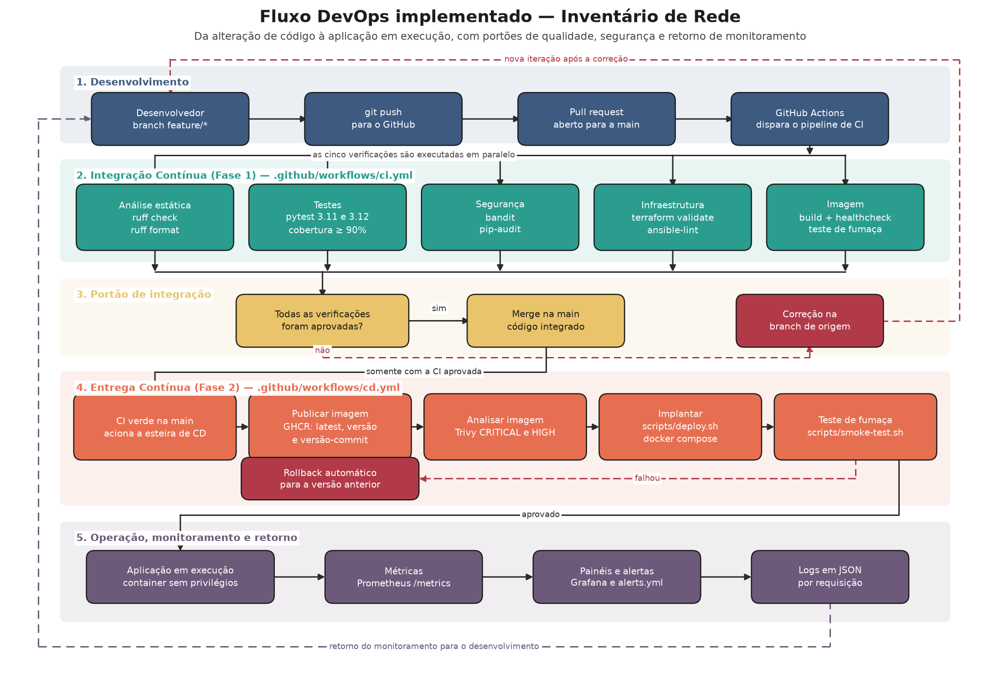

# Inventário de Rede — Projeto DevOps na Prática

Aplicação de referência construída para o projeto da disciplina **DevOps na
Prática** (PUCRS). Trata-se de uma API de inventário de equipamentos de rede
— roteadores, switches, OLTs, firewalls e servidores — usada como base para
montar, ponta a ponta, uma esteira de integração contínua, entrega contínua,
containerização, monitoramento e segurança.

A aplicação é intencionalmente pequena. O objeto de estudo não é o domínio de
negócio, e sim o caminho que uma alteração percorre desde o `git push` até o
ambiente em execução.

- **Fase 1 — Configuração e Automação Inicial:** repositório, pipeline de CI e
  scripts de infraestrutura como código.
- **Fase 2 — Entrega Contínua, Monitoramento e Segurança:** expansão do
  pipeline para CD, containerização, orquestração, scripts de deploy,
  observabilidade e verificações de segurança.

## Sumário

- [Arquitetura](#arquitetura)
- [Fluxo DevOps implementado](#fluxo-devops-implementado)
- [Estrutura do repositório](#estrutura-do-repositório)
- [Executando localmente](#executando-localmente)
- [Endpoints da API](#endpoints-da-api)
- [Qualidade e testes](#qualidade-e-testes)
- [Pipeline de Integração Contínua](#pipeline-de-integração-contínua)
- [Pipeline de Entrega Contínua](#pipeline-de-entrega-contínua)
- [Infraestrutura como Código](#infraestrutura-como-código)
- [Containerização e orquestração](#containerização-e-orquestração)
- [Monitoramento e logging](#monitoramento-e-logging)
- [Segurança](#segurança)

## Arquitetura

| Camada | Tecnologia | Papel |
|---|---|---|
| Aplicação | Python 3.12 + FastAPI + Pydantic | API REST do inventário |
| Testes | pytest + pytest-cov | 13 testes, cobertura mínima de 90% |
| Qualidade | Ruff | lint e formatação |
| Segurança | Bandit, pip-audit, Trivy | código, dependências e imagem |
| Container | Docker (multi-stage) | empacotamento da aplicação |
| Orquestração | Docker Compose | API, Prometheus e Grafana |
| Infraestrutura | Terraform + Ansible | provisionamento e configuração |
| Observabilidade | Prometheus + Grafana + logs JSON | métricas, alertas e logs |
| Automação | GitHub Actions | pipelines de CI e CD |

## Fluxo DevOps implementado



O desenvolvedor abre uma branch `feature/*`, envia o código e o pipeline de CI
executa cinco verificações em paralelo. Aprovadas todas elas, o pull request
pode ser integrado à `main`. A integração na `main` dispara novamente a CI e,
somente se ela terminar com sucesso, o pipeline de CD publica a imagem no
GitHub Container Registry, analisa a imagem com o Trivy, implanta o ambiente
com `scripts/deploy.sh` e valida a implantação com o teste de fumaça. Qualquer
falha nessa última etapa aciona o rollback automático para a versão anterior.

## Estrutura do repositório

```
.
├── app/                        Código da aplicação FastAPI
│   ├── main.py                 Rotas HTTP e ciclo de vida
│   ├── models.py               Modelos e validações de entrada
│   ├── observability.py        Logging JSON e métricas Prometheus
│   └── storage.py              Repositório de equipamentos
├── tests/                      Suíte de testes automatizados
├── infra/
│   ├── terraform/              Provisionamento do ambiente (IaC)
│   └── ansible/                Configuração do host de aplicação
├── monitoring/                 Prometheus, regras de alerta e Grafana
├── scripts/
│   ├── deploy.sh               Deploy com healthcheck e rollback
│   └── smoke-test.sh           Teste de fumaça pós-deploy
├── docs/                       Fluxograma e documentação de apoio
├── .github/workflows/
│   ├── ci.yml                  Pipeline de Integração Contínua (Fase 1)
│   └── cd.yml                  Pipeline de Entrega Contínua (Fase 2)
├── Dockerfile                  Imagem multi-stage sem privilégios
└── docker-compose.yml          Orquestração local da stack completa
```

## Executando localmente

Com Python:

```bash
python3 -m venv .venv && source .venv/bin/activate
pip install -r requirements-dev.txt
uvicorn app.main:app --reload
```

Com a stack completa em containers:

```bash
docker compose up -d --build
curl http://localhost:8000/health
```

A API fica em <http://localhost:8000>, a documentação interativa em
<http://localhost:8000/docs>, o Prometheus em <http://localhost:9090> e o
Grafana em <http://localhost:3000>.

## Endpoints da API

| Método | Rota | Descrição |
|---|---|---|
| `GET` | `/health` | Saúde do serviço, usada pelo healthcheck do container |
| `GET` | `/metrics` | Métricas no formato de exposição do Prometheus |
| `GET` | `/api/v1/devices` | Lista equipamentos, com filtros `site` e `status` |
| `GET` | `/api/v1/devices/{id}` | Consulta um equipamento |
| `POST` | `/api/v1/devices` | Cadastra um equipamento |
| `PATCH` | `/api/v1/devices/{id}` | Atualiza parcialmente um equipamento |
| `DELETE` | `/api/v1/devices/{id}` | Remove um equipamento |

## Qualidade e testes

```bash
ruff check .            # lint
ruff format --check .   # formatação
pytest                  # testes e cobertura mínima de 90%
```

A suíte cobre o caminho feliz e os casos de erro: nome duplicado (409),
IPv4 inválido (422), papel inexistente (422), identificador inexistente (404)
e a normalização automática do nome do equipamento.

## Pipeline de Integração Contínua

Definido em [`.github/workflows/ci.yml`](.github/workflows/ci.yml), roda em
cada push e cada pull request:

1. **Análise estática** — `ruff check` e `ruff format --check`.
2. **Testes automatizados** — matriz de Python 3.11 e 3.12, com cobertura
   mínima de 90% imposta pelo próprio pytest.
3. **Verificações de segurança** — `bandit` no código e `pip-audit` nas
   dependências.
4. **Validação da infraestrutura** — `terraform fmt`, `terraform validate`,
   `ansible-playbook --syntax-check` e `ansible-lint`.
5. **Construção da imagem** — build da imagem, subida do container, espera do
   healthcheck e execução do teste de fumaça.

O job final `integracao-aprovada` só é concluído quando todos os anteriores
passam, servindo como verificação obrigatória para a integração na `main`.

## Pipeline de Entrega Contínua

Definido em [`.github/workflows/cd.yml`](.github/workflows/cd.yml), é acionado
por `workflow_run` quando a CI termina com sucesso na `main`:

1. **Publicar** — build e publicação no GitHub Container Registry com três
   rótulos: `latest`, a versão da aplicação e `versão-commit`.
2. **Analisar** — varredura da imagem publicada com o Trivy.
3. **Implantar** — `scripts/deploy.sh` baixa a imagem, sobe a stack, aguarda o
   healthcheck e executa o teste de fumaça; qualquer falha dispara o rollback.

```bash
./scripts/deploy.sh 1.2.0-a1b2c3d 8000   # deploy de uma versão específica
./scripts/smoke-test.sh http://localhost:8000
```

## Infraestrutura como Código

**Terraform** ([`infra/terraform/`](infra/terraform)) descreve o ambiente de
execução: rede isolada, imagem e as réplicas da API, com variáveis validadas
para ambiente, porta, número de réplicas e nível de log.

```bash
terraform -chdir=infra/terraform init
terraform -chdir=infra/terraform plan -var 'replicas=2'
terraform -chdir=infra/terraform apply -auto-approve
terraform -chdir=infra/terraform destroy -auto-approve
```

**Ansible** ([`infra/ansible/`](infra/ansible)) configura o host de aplicação:
pacotes de apoio, diretório da aplicação, arquivo de ambiente e rotação de
logs. O playbook é idempotente e passa no `ansible-lint` em perfil `production`.

```bash
ansible-playbook -i inventory.ini playbook.yml --check --diff
ansible-playbook -i inventory.ini playbook.yml
```

## Containerização e orquestração

O [`Dockerfile`](Dockerfile) usa build multi-stage: o primeiro estágio instala
as dependências e o segundo copia apenas o necessário para uma imagem
`python:3.12-slim`. O container roda como usuário sem privilégios (`uid 10001`),
com sistema de arquivos somente leitura, `no-new-privileges` e todas as
capabilities removidas, e declara o próprio healthcheck.

O [`docker-compose.yml`](docker-compose.yml) orquestra os três serviços da
stack — API, Prometheus e Grafana —, com rede dedicada, volumes nomeados,
limite de rotação dos logs e dependência condicionada à saúde da API.

## Monitoramento e logging

A aplicação expõe métricas em `/metrics` por meio de um middleware que
contabiliza `inventario_http_requests_total` (por método, rota e status) e
`inventario_http_request_duration_seconds` (histograma de latência). O
Prometheus coleta a cada 15 segundos e avalia as regras de
[`monitoring/alerts.yml`](monitoring/alerts.yml): indisponibilidade da API,
taxa de erro 5xx acima de 5% e percentil 95 de latência acima de 500 ms. O
Grafana recebe a fonte de dados já provisionada.

Os logs saem em JSON, uma linha por requisição, com método, rota, status e
duração em milissegundos — formato pronto para ingestão por um agregador.

## Segurança

| Camada | Controle |
|---|---|
| Código | Bandit em todo o pacote `app` no pipeline de CI |
| Dependências | `pip-audit --strict` sobre as versões fixadas |
| Imagem | Trivy sobre a imagem publicada (CRITICAL e HIGH) |
| Execução | usuário sem privilégios, `read_only`, `cap_drop: ALL`, `no-new-privileges` |
| Pipeline | permissões mínimas por workflow (`contents: read`) e segredos providos pelo GitHub |
| Entrada | validação de IPv4, tamanho e enums via Pydantic, com rejeição em 422 |

## Licença

Trabalho acadêmico produzido para a disciplina DevOps na Prática da PUCRS.

## Native OpenTelemetry

The inventory service uses FastAPI 0.143.0 and its native OpenTelemetry integration. It does not configure a collector by default. Existing Prometheus `/metrics` and JSON application logging remain available independently. To enable automatic export of native HTTP traces, request metrics, validation/error logs, and WebSocket traces/logs, set `FASTAPI_OTEL_AUTO_CONFIGURE=true` and `OTEL_EXPORTER_OTLP_ENDPOINT` before starting the service. Set `OTEL_SERVICE_NAME` only if a custom service name is needed. Signal-specific `OTEL_EXPORTER_OTLP_TRACES_ENDPOINT`, `OTEL_EXPORTER_OTLP_METRICS_ENDPOINT`, and `OTEL_EXPORTER_OTLP_LOGS_ENDPOINT` take precedence for their signals. `OTEL_SDK_DISABLED=true` disables SDK setup, and the standard signal exporter `none` controls remain supported. An explicitly empty base endpoint leaves automatic base export unconfigured.

Native privacy processors remove concrete request paths, query values, and arbitrary exception messages/stack traces while retaining route templates, timing, and exception classification. They operate on the providers selected by the application. Applications embedding `create_app(telemetry=...)` retain their caller-owned providers. Callers that configure their own exporters should set `auto_configure=False`, install the privacy processors before their exporter processors, and own flushing and shutdown. Earlier caller-installed log exporters require caller-managed processor ordering.

The factory copies the caller's telemetry configuration. When `OTEL_SDK_DISABLED=true`, it disables native auto-configuration, tracing, metrics, and logs without mutating the caller's mapping or replacing its providers. Privacy processors still sanitize selected existing SDK providers. Automatic proxy-provider replacement requires the SDK, signal, auto-configuration, exporter, and endpoint controls to permit export.

The subprocess OTLP contract tests decode actual local protobuf exports and verify privacy, signal controls, explicit providers, repeated lifespans, and the unconfigured default. The SDK-disabled regression probes exercise active caller-owned trace, metric, and log exporters with explicit and global providers, success responses, validation failures, application errors, and repeated lifespans. They separately observe earlier caller-installed log exporters during the disabled phase and later exporters after privacy processors are installed; they do not claim that a later processor can redact a record already exported by an earlier processor. Coverage includes subprocess execution and retains the existing 90% gate. Routine tests disable ambient telemetry to avoid exporting test traffic.

Native FastAPI automatic setup is opt-in through `FASTAPI_OTEL_AUTO_CONFIGURE=true`.
An explicit caller `auto_configure` dictionary value takes precedence. Endpoint
values alone do not enable automatic setup. SDK disabling copies and disables
all four native controls while preserving selected caller privacy and ownership.
